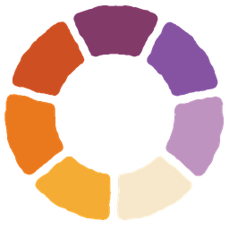

# 7Lights brand guide

**Afterglow** is the 7Lights identity within the **Cut From Life** art direction. It pairs a dark espresso interface with everyday photography, cut paper, and the colors of the last light at dusk. Vision boards feel personal and assembled by hand. Challenges keep the next action easy to find.

## Name and voice

Write the product name **7Lights**. Use a numeral, a capital L, and no space. **Seven Lights** is the English title of the board library. **Siete Luces** is its Spanish title.

Write plain, specific actions, such as **Add image**, **Do day 8**, and **Done**. English is the reference language for these designs. The app also supports Rioplatense Spanish and follows the device locale. Preserve a person’s own words in either language.

## Ember Ring

The mark has seven hand-cut sectors with a clear center and seven open gaps. Start at twelve o’clock and move clockwise through plum, violet, mauve, cream, honey, amber, and burnt orange. The slightly uneven edges give it its paper-cut character. Keep those edges, the dark center, and the order of the colors when scaling it. Use the complete ring with the cream wordmark for sign-in and sharing. Use the ring alone on the dark plum **#321928** app icon. The Android themed icon uses a single-color mask with the same seven gaps.

Use the [vector master](../assets/brand/ember-ring.svg) for new exports. At favicon size the open center and gaps matter more than edge detail. Leave at least one sector’s thickness of clear space around the mark. Use an espresso or dark plum ground for the colored version.

## Color

| Brand color | Hex | Use |
| --- | --- | --- |
| Plum | `#823A69` | Ring, paper layers |
| Violet | `#8653A2` | Ring, supporting accents |
| Mauve | `#BE93BF` | Ring, breathing challenge controls and progress |
| Cream | `#F7E7CB` | Ring, wordmark, primary text, sign-in action |
| Honey | `#F5AC34` | Ring, breathing check-in action, warm highlights |
| Amber | `#EA791E` | Ring, lit paper and photography |
| Burnt orange | `#CE5022` | Ring, selective artwork accents |

Use espresso `#191111` for the page, `#231918` for inset areas, and `#2D211F` for cards. Use cream for primary text and the warm neutrals in [theme tokens](../src/theme/tokens.ts) for secondary text. Set espresso text on cream, mauve, and honey buttons. Use text or a symbol as well as color to communicate completion and other states.

Chakra colors remain functional. Green identifies Heart and may appear in its thumbnails or category controls. Blue serves Throat. Keep both out of the Ember Ring and brand color swatches. Other functional status colors belong to their controls.

## Type

| Role | Family | Usage |
| --- | --- | --- |
| Wordmark and primary titles | Bricolage Grotesque ExtraBold | Compact, soft-edged headings |
| Card headings | Bricolage Grotesque Bold | Strong hierarchy at small sizes |
| Body and controls | Instrument Sans Regular, Medium, Bold | Comfortable reading, distinct actions |
| Prompts and quotations | Instrument Sans Italic | Occasional emphasis |
| Chakra seed syllables | Noto Serif Devanagari | Preserve the original script |

Use the numeric timer as a stable focal point. Allow long names and localized labels to wrap. At larger system font sizes, give lists more room and let Explore use one column.

## Photography and collage

Use real-feeling objects and moments: a curtain catching light at blue hour, an open notebook, water around a slice of orange, the texture of stones or leaves. Let side light and shadow carry the mood. Layer one or two pieces of torn tissue or warm cream paper. Use the edge treatment inside artwork and as a small accent on shared cards. Keep form fields, labels, and navigation on plain surfaces.

The built-in chakra covers are decorative. A person’s photos take priority in board previews and shared cards. Keep text out of the image files so each locale and assistive technology can read it.

## Product applications

- **Sign-in.** Ember Ring and wordmark, one dusk-curtain collage, an email field, and a cream action.
- **Boards.** Seven image-led rows in root-to-crown order. An open board pairs a cover and the existing intention, affirmation, words, and images.
- **Challenges.** Art-led discovery cards, visible progress, and a clear daily action. Keep the numbered days available for opening previous entries. The official mindful breathing challenge uses the dusk art and mauve controls.
- **Breathing and check-in.** A translucent amber paper disc grows and settles behind a steady clock. Keep the timer controls separate. Pair the optional note with a clear share switch and a honey Done button for the breathing challenge.
- **Explore and sharing.** Use a compact, two-column feed where it fits. Story cards use a 9:16 frame, the person’s own images and words where available, and a small Ember Ring lockup near the bottom.

Production art is in [assets/brand](../assets/brand). Platform icons are in [assets/images](../assets/images). Use the current in-app components and shared tokens when translating a mockup to code.
